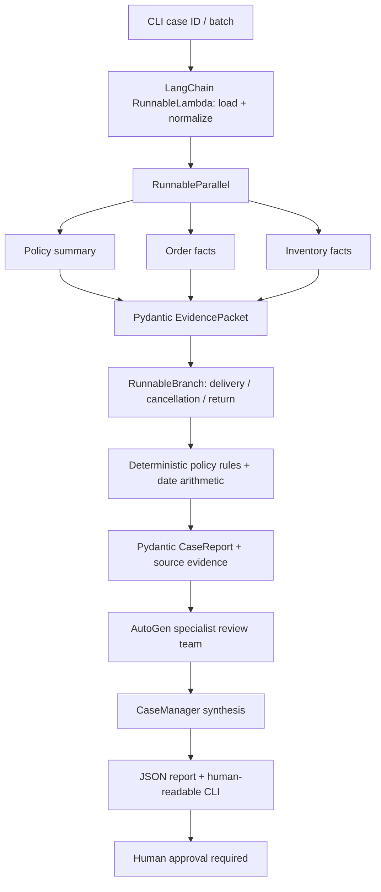

# Group 2 — Retail Order Exception & Refund Eligibility Review

A local, read-only case investigation app built from the supplied Group 2 assignment and fictional datasets. It combines a **LangChain Core evidence pipeline** with a **four-role AutoGen AgentChat review**. The default mode is deterministic/offline, so the demo works without API credentials.

## What it does
- Processes one case (`C001`) or the supplied batch of 11 cases.
- Loads case, order, inventory and return-policy evidence from `data/`.
- Uses `RunnableLambda`, `RunnableParallel` and `RunnableBranch` in LangChain Core.
- Computes the 30-calendar-day window in Python. Day 30 is inclusive.
- Validates reports with Pydantic enums and typed evidence records.
- Runs read-only specialist review roles: PolicyReviewer, OrderInvestigator, InventoryChecker and CaseManager. Offline mode is explicitly labelled; optional real AutoGen AgentChat is available with a configured model key.
- Writes machine-readable JSON and a short CLI explanation.
- Never changes order/payment/inventory data. Every action remains human-approved.

## Quick start (Python 3.11 or 3.12)

```bash
python -m venv .venv
# Windows: .venv\Scripts\activate
source .venv/bin/activate
pip install -r requirements.txt
```

Run a single case:

```bash
python -m app.main --case C001
```

Run all supplied cases:

```bash
python -m app.main --all --json-out reports/all_cases.json
```

Skip specialist review:

```bash
python -m app.main --all --no-agents
```

Run tests:

```bash
pytest -q
```

## Optional real AutoGen AgentChat

Offline deterministic specialist review is the default. To enable model-assisted AgentChat, copy `.env.example` to `.env`, set `AUTOGEN_ENABLED=true` and `OPENAI_API_KEY`, then export the variables in your shell (or load them with python-dotenv in your launcher). The adapter uses the modern `autogen_agentchat` / `autogen_ext` API family and a `RoundRobinGroupChat` with a four-message cap. Model text is advisory only: it cannot override records or trigger transactions. If configuration or model execution fails, the application falls back to the clearly labelled offline review.

## Architecture



### LangChain and AutoGen trade-offs

| Choice | Why | Limitation |
|---|---|---|
| LangChain Core runnables | Explicit, testable loading, parallel evidence extraction and routing | Business decisions remain deterministic Python rules |
| `RunnableParallel` | Policy, order and inventory facts are independent reads | Local CSV reads are small; parallelism is mainly architectural clarity |
| `RunnableBranch` | Makes delivery/cancellation routing visible | Final eligibility is still governed by deterministic rules |
| AutoGen `RoundRobinGroupChat` | Guarantees each specialist gets a review turn; easy to demo | Fixed order is less adaptive than selector-based routing |
| Offline specialist mode | Reproducible demos without credentials or network | Not an LLM conversation; labelled honestly as deterministic review |

## Demonstration runs

| Case | Expected result | Why |
|---|---|---|
| C001 | `REPLACE_REVIEW` | Damaged headphones, within window, stock available |
| C002 | `INVESTIGATE_DELIVERY` | Delivered status conflicts with customer's non-receipt claim |
| C004 | `NOT_ELIGIBLE` | Request is beyond 30 days after delivery |
| C007 | `REFUND_REVIEW` | Cancelled order with captured payment; verify transaction |
| C008 | `MANUAL_REVIEW` | Requested INR 50,000 differs from recorded INR 2,499 |
| C009 | `REQUEST_INFO` | Unknown order ID; no invented order facts |
| C011 | `REFUND_REVIEW` | Exactly day 30; policy window is inclusive |

## Evidence and safety

Evidence entries identify their source file and record/field reference. Customer statements are labelled `customer_claim`; order facts are `verified_fact`; inventory lookup results are `tool_observation`. The policy clauses used are recorded in `policy_clause`. Missing policy produces `MANUAL_REVIEW`. Unknown order produces `REQUEST_INFO`. No tool can write to CSVs, payment systems or inventory. `needs_human_approval` is always true and `approval_status` remains `REVIEW_REQUIRED`.

## Tests and known limitations

The test suite covers the supplied acceptance cases, inclusive day-30 and day-31 boundaries, unknown order, missing policy, contradictory delivery claim, invalid enum-shaped output, idempotent deterministic results and non-mutation of data. The optional live AutoGen path requires compatible installed packages and a valid model API key. The app uses fictional CSV records, has no authentication or production integrations, and does not execute refunds, replacements or cancellations.

## Project layout

```text
app/       pipeline, deterministic decision rules, schemas, AutoGen adapter, CLI
 data/     supplied fictional cases, orders, inventory and policy
 tests/    deterministic pytest suite
docs/      original assignment document
reports/   generated JSON reports (created at runtime)
```
